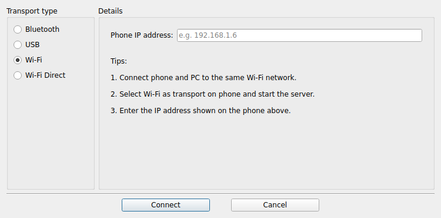

# WO Mic Linux GUI (unofficial)

Use your Android/iPhone as a microphone on Linux. This project is a small Qt desktop app and installer around the official [WO Mic](https://wolicheng.com/womic/) Linux client. The app looks like the Windows client, and the installer handles the audio plumbing so the phone shows up as a normal **WO-Mic** input that works in Discord, OBS, Zoom, browsers and other apps.

> **Not affiliated with Wolicheng Tech.** "WO Mic" and the `micclient` binary are © Wolicheng Tech. This repository contains only the GUI, scripts and config. The installer downloads the client binary from the official website.



## Features

- A connect dialog modeled on the Windows client, with **Wi-Fi**, **Wi-Fi Direct** and **Bluetooth** (paired-device picker).
- Creates a proper **WO-Mic** PipeWire/PulseAudio input and can set it as the default microphone.
- Avoids the `snd-aloop` start-order problem: micclient opens the loopback device before the WO-Mic input does.
- Remembers your last transport and phone address.
- Includes a CLI script (`womic <phone-ip>`) if you don't want the GUI.
- Per-user install, with a one-command uninstall.

## Requirements

- Linux on **x86_64**, the only architecture micclient supports.
- PipeWire (with `pipewire-pulse`) or PulseAudio.
- Python 3 with PyQt6. The installer installs it on Debian/Ubuntu/Mint, Fedora and Arch.
- The WO Mic app on your phone ([Google Play](https://play.google.com/store/apps/details?id=com.wo.voice2) / App Store).

## Install

```bash
git clone https://github.com/najjar320/womic-linux.git
cd womic-linux
./install.sh
```

The installer:
1. Installs `python3-pyqt6` and `curl` if they are missing.
2. Downloads `micclient-x86_64.AppImage` from `wolicheng.com` and checks its SHA-256.
3. Loads the `snd-aloop` kernel module and enables it at boot. This step uses `sudo`.
4. Installs the app to `~/.local/share/womic-linux`, a menu entry, and the commands `womic-gui` and `womic`.
5. Adds a PipeWire config that creates the **WO-Mic** input at login.

## Usage

1. On the phone, open WO Mic, choose **Wi-Fi** (or Bluetooth) as the transport, and press **Start**.
2. On the PC, open **WO Mic Client** from the app menu.
3. Pick the transport, enter the IP shown on the phone (or select the paired phone), and click **Connect**.
4. In your app (Discord, OBS, …), select **WO-Mic** or **Default** as the input device.

CLI alternative:

```bash
womic 192.168.1.6          # Wi-Fi
womic -b AA:BB:CC:DD:EE:FF # Bluetooth
```

## Troubleshooting

| Problem | Fix |
|---|---|
| `Fail to connect to server` | Press **Stop** then **Start** in the phone app, and make sure both devices are on the same network. |
| `unable to set hw parameters` | Another app opened the loopback first. Reconnect from the GUI or `womic`, which handle this automatically. |
| Connected but the mic is silent | Select the **WO-Mic** input, not "Loopback Analog Stereo". The loopback's playback side is captured on `hw:Loopback,1,0`. |
| Audio glitches | Upstream recommends running micclient as root for more aggressive scheduling. |
| USB transport | Not supported by the Linux client. Use Wi-Fi, or USB tethering combined with Wi-Fi mode. |

## How it works

```
phone ──Wi-Fi/BT──► micclient ──► hw:Loopback,0,0 (snd-aloop) ──► hw:Loopback,1,0 ──► "WO-Mic" source ──► Discord/OBS/…
```

`snd-aloop` requires the second opener of a loopback cable to use the same buffer parameters as the first. The app therefore unloads the WO-Mic source, starts micclient, waits for the stream to run, and then loads the source again.

## Uninstall

```bash
./uninstall.sh
```

## Project layout

```
womic_gui.py              Qt GUI
womic.sh                  CLI launcher
run.sh                    Run the GUI straight from the repo (development)
install.sh / uninstall.sh Installer
config/womic-pipewire.conf  PipeWire config that creates the WO-Mic input
docs/                     Screenshots
```

## License

The code in this repository is under the [MIT](LICENSE) license. The WO Mic client binary is proprietary, is **not** included, and is subject to Wolicheng Tech's terms.
